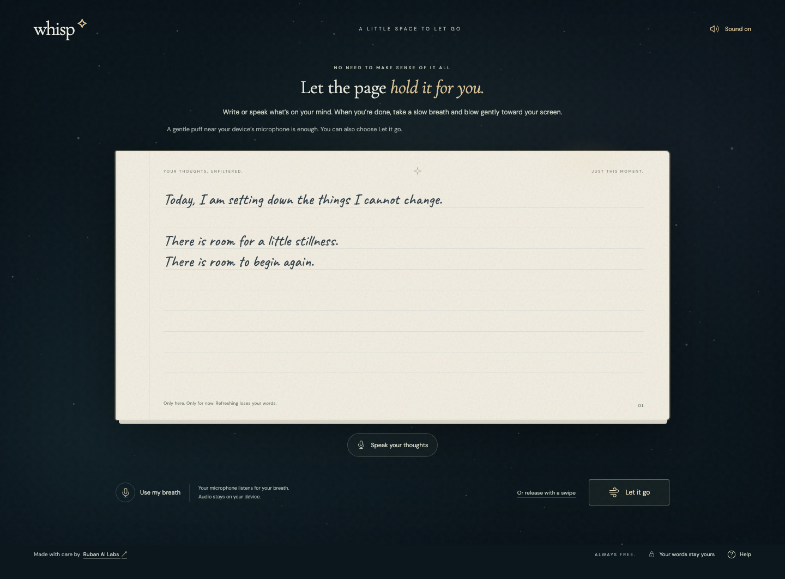

<p align="center"></p>

# Whisp

**A little space to let go.**

Whisp is a free, private online notebook for the thoughts you are ready to set down. Write or speak at your own pace, take a comfortable breath, and watch your words drift away. An original supportive note appears when the page clears.

Built by **[Ruban AI Labs](https://labs.rubangino.ca/)**. Production domain: **[whisp.rubangino.ca](https://whisp.rubangino.ca/)**.



## The experience

- **Write without signing up.** A native, editable notebook supports multiline text, selection, paste, Unicode, and keyboard undo.
- **Speak privately.** Optional English voice typing runs a self-hosted Whisper Tiny model on the visitor’s device. Recognized phrases append to the page; non-speech annotations are filtered.
- **Release at your own pace.** Blow gently near the device’s microphone, confirm **Let it go**, or choose an intentional swipe. There is no need to blow hard.
- **Find a little encouragement.** One of 100 original supportive notes appears after release, with local theme matching and randomized rotation.
- **Enjoy a quiet atmosphere.** Cosmic journeys, paper-to-light transitions, original ambient music, and gentle wind effects share one sound control.
- **Use the screen comfortably.** Layouts adapt to phones, tablets, desktop, landscape, and short viewports. Reduced motion, keyboard navigation, accessible controls, and a 20-second restore option are included.

Microphone use is disclosed before entry and can be turned off. Sound starts after interaction and can be muted. Voice typing has a separate first-use explanation and enable action.

## Privacy

Whisp has no accounts, analytics, application backend, saved drafts, or cloud transcription.

| Data | Handling |
| --- | --- |
| Writing | Temporary tab memory; never written to local/session storage, cookies, or a database. Refreshing or closing loses it. |
| Released writing | Available through **Bring it back** for 20 seconds. Expiry, beginning again, or returning home drops the restore copy. |
| Microphone audio | Breath is analyzed locally. Voice uses short in-memory audio segments, then clears/discards them and terminates its worker. Nothing is uploaded. |
| Speech-model files | Public assets served from this site. The app-owned model cache clears automatically after successful release or return home; Help offers manual clearing. |
| Supportive-note selection | Local keywords and quote IDs; no user profile or remote analysis. |

Optional voice typing initially transfers about **70 MB** of public model/runtime assets. Clearing the cache can require another download. Ordinary browser caches, memory reclamation, browser extensions, operating-system behavior, and host access logs are outside the app’s control; secure memory erasure cannot be guaranteed.

Speech recognition and breath detection can make mistakes. Every transcript is editable, and typing/manual release remain available. Whisp is a reflective experience, not medical care or a promise of relief.

## Local development

Use **Node.js 24 LTS** (`.nvmrc`), or another version supported by `package.json`.

```sh
npm ci
npm run dev
```

Open **http://127.0.0.1:5173/**. No `.env` file, API key, database, or application secret is required. Microphone features need localhost or HTTPS.

Before development and production builds, the preparation script downloads pinned public speech assets from Hugging Face and copies the installed WASM runtime. The first preparation requires internet access; subsequent runs reuse verified local files. Generated speech directories are excluded from Git and included in the production output.

## Validation

```sh
npm test                  # Unit tests
npm run typecheck         # Strict TypeScript
npx playwright install chromium firefox webkit
npm run test:e2e           # Desktop and phone-emulation browser matrix
npm run build             # Prepare assets, typecheck, compile, pre-render, verify release
npm run verify:release    # Recheck the existing dist/ artifact
npm run preview           # Serve dist/ at http://127.0.0.1:4173/
```

With the production preview running:

```sh
node scripts/verify-production.mjs
node scripts/verify-voice.mjs
```

Set `WHISP_BROWSER=firefox` or `WHISP_BROWSER=webkit` to run the production smoke check in those engines.

The checks cover production hydration/security policy, a readable homepage without JavaScript, release/restore, metadata, asset responses, storage, silence rejection, and real local recognition of a public speech fixture. For installed Brave, set `WHISP_BRAVE_EXECUTABLE` to its executable path when running Playwright. Browser tests use isolated profiles.

GitHub Actions runs unit tests and the complete production build on pushes to `main` and pull requests. It does not deploy. Physical microphone, actual phone, virtual-keyboard, and assistive-technology checks remain part of manual release validation. See [Testing](docs/TESTING.md).

## Production deployment

The application builds into **`dist/`**, including speech assets and a pre-rendered public homepage. The interactive notebook remains entirely in the browser; pre-rendering never includes user writing or recordings.

| Setting | Value |
| --- | --- |
| Framework | Vite |
| Install | `npm ci` |
| Build | `npm run build` |
| Output | `dist` |
| Node.js | 24 LTS |
| Canonical domain | `https://whisp.rubangino.ca/` |

`vercel.json` includes build settings, security headers, immutable hashed-asset caching, and no-store headers for speech downloads. `_headers` supplies equivalents for compatible static hosts. No inference server, API key, or cross-origin model fallback is needed.

Choose a hosting plan appropriate to this project’s use and bandwidth. Vercel Hobby eligibility is restricted to personal, non-commercial use; free access for visitors alone does not establish eligibility. See the [deployment guide](docs/DEPLOYMENT.md) for plan details, HTTPS/DNS, and launch checks. Deployment is performed by the owner.

## Search and sharing

The public landing page is pre-rendered for crawlers and visitors, with production canonical metadata, Open Graph/Twitter cards, WebSite/WebApplication/Organization structured data, robots.txt, sitemap.xml, and SVG/ICO/PNG/Apple icons. No invented reviews, ratings, or search-ranking claims are included.

After launch, verify the domain in Google Search Console and submit `https://whisp.rubangino.ca/sitemap.xml`. See [SEO and launch verification](docs/SEO.md).

## Project documentation

- [Architecture](docs/ARCHITECTURE.md)
- [Testing and device checklist](docs/TESTING.md)
- [Deployment](docs/DEPLOYMENT.md)
- [SEO and launch verification](docs/SEO.md)
- [Feature updates](docs/FEATURE_UPDATES.md)
- [Third-party licenses and attribution](THIRD_PARTY_NOTICES.md)

**Developer:** [Ruban AI Labs](https://labs.rubangino.ca/) · **Source:** [Ruban2205/whisp.rubangino.ca](https://github.com/Ruban2205/whisp.rubangino.ca)
